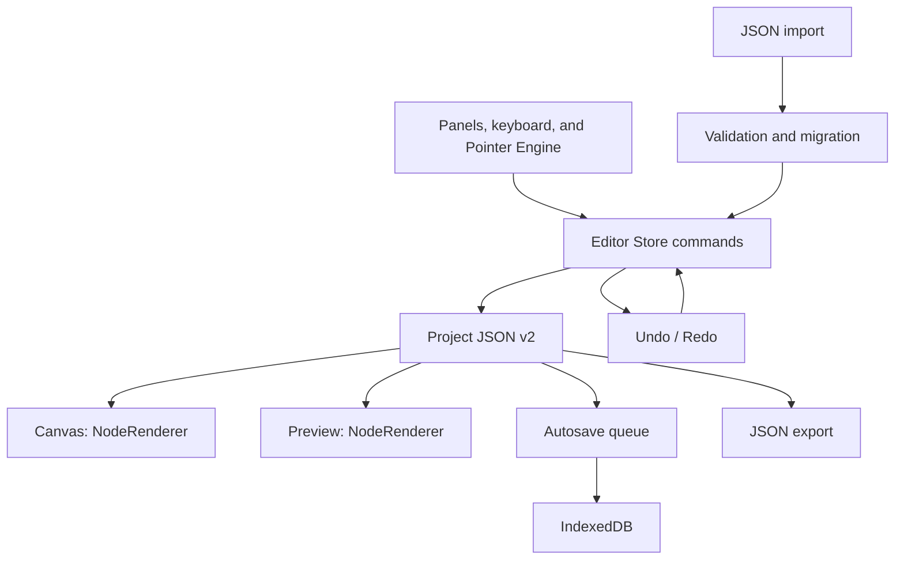

# Forma — Universal Visual UI Builder

**A visual interface builder with local project storage.**

Design on a freeform canvas: add components, arrange nested layers, and customize typography, icons, and effects. Save projects in your browser and move them between devices using JSON.

**Version:** 0.2.0 · **Mode:** Free Design · **Editor language:** Russian · **Storage:** IndexedDB

**Repository:** [TikTak-creator/Universal_Ai_Builder](https://github.com/TikTak-creator/Universal_Ai_Builder)


> The current release includes the working core editor and Visual Toolkit v0.2. It supports creating and editing interface mockups. HTML/CSS, React, and Flutter generation, responsive layouts, custom interactions, and animation tools are planned for future releases.

## Contents

- [About the project](#about-the-project)
- [Quick start](#quick-start)
- [Features](#features)
- [Your first design](#your-first-design)
- [Customization](#customization)
- [Keyboard shortcuts](#keyboard-shortcuts)
- [Saving and transferring projects](#saving-and-transferring-projects)
- [How the editor works](#how-the-editor-works)
- [Document format](#document-format)
- [Repository structure](#repository-structure)
- [Development and testing](#development-and-testing)
- [Limitations](#limitations)
- [Roadmap](#roadmap)
- [Extending the project](#extending-the-project)
- [Publishing](#publishing)
- [Troubleshooting](#troubleshooting)
- [Further documentation](#further-documentation)
- [Assets and licenses](#assets-and-licenses)

## About the project

Forma is a browser application for assembling interfaces visually, from a small form to an application screen, landing page, or dashboard. Elements use pixel coordinates, and their appearance is controlled through the property inspector.

The editor brings together three parts of the design workflow:

1. **Composition:** a component library, canvas, layer tree, and nested containers.
2. **Styling:** icons, project fonts, independent corner radii, gradients, shadows, and typography.
3. **Persistence:** local autosave, project management, and editable document import and export.

No account, application backend, server database, or API keys are required. The application currently has no AI service integrations or paid API dependencies.

Once dependencies are installed, the local editor can run without an internet connection. Icons, Manrope, and templates are bundled with the project. Images referenced by external URLs still require access to their source sites. A PWA installation flow and a Service Worker for offline access to a hosted deployment are not implemented.

### Suitable use cases

- Exploring screen composition and visual direction.
- Creating mockups of forms, cards, sections, and application screens.
- Experimenting with typography, colors, corner radii, and effects.
- Studying visual editor architecture with React and TypeScript.
- Building a foundation for a more advanced UI builder.

## Quick start

### Requirements

- **Node.js 22 or newer** and npm.
- A modern desktop browser with IndexedDB, Pointer Events, and FontFace support.
- Internet access for the initial npm dependency installation.

The editor is designed for a mouse and keyboard. A dedicated mobile workflow with touch gestures is not implemented.

### Clone and run

```bash
git clone https://github.com/TikTak-creator/Universal_Ai_Builder.git
cd Universal_Ai_Builder
npm ci
npm run dev
```

Open **[http://127.0.0.1:5173/](http://127.0.0.1:5173/)**.

If you downloaded the source as a ZIP, extract it and run `npm ci` and `npm run dev` in the directory containing `package.json`.

The development command binds Vite to `127.0.0.1`. Port `5173` is fixed with `--strictPort`: the server exits with an error if the port is already in use. Stop the server with `Ctrl + C` in its terminal.

### Windows launcher

Double-click **[START.cmd](START.cmd)**. The script:

1. Changes to the project directory.
2. Checks whether npm is available.
3. Installs dependencies using `npm ci` if Vite has not been installed.
4. Starts the editor and opens your browser.

Keep the terminal window open while using the local server.

### Available commands

| Command | Purpose |
| --- | --- |
| `npm ci` | Install dependencies from `package-lock.json` |
| `npm run dev` | Start the development server at `127.0.0.1:5173` |
| `npm run typecheck` | Check TypeScript using `tsc -b` |
| `npm test` | Run the Vitest suite once |
| `npm run test:watch` | Run Vitest in watch mode |
| `npm run build` | Check TypeScript and build the application into `dist/` |
| `npm run preview` | Serve the existing production build locally |

To preview a production build:

```bash
npm run build
npm run preview
```

Vite prints the preview URL in the terminal. Preview may use a different project store from development because it runs on a different port.

## Features

### Canvas and editing

- Freeform element placement in **Free Design** mode.
- Zoom from **10% to 800%** and canvas panning.
- An **8 px** grid, grid snapping, smart guides, and rulers.
- Guides that can be dragged from rulers, repositioned, and removed with a double-click.
- Click selection, `Shift + click`, and marquee selection.
- `Alt + marquee` to include nested elements in the selection.
- Moving multiple selected elements together.
- Eight resize handles and rotation for individual elements.
- Aspect ratio preservation and 15° rotation increments with `Shift`.
- Alignment, distribution, grouping, and layer ordering.
- Undo/redo, duplication, copy, cut, paste, and a context menu.

### Layers

The layer tree reflects the project hierarchy. Search for elements, collapse branches, drag layers to change order or nesting, and hide or lock elements.

A parent's hidden and locked states apply to its descendants. Reparenting preserves the element's position and rotation on the canvas. Tree operations prevent cycles.

### Component library

| Category | Components |
| --- | --- |
| Structure | Frame, Container |
| Basic | Text, Image, Icon, Shape, Line, Divider |
| Forms | Button, Input, Textarea, Checkbox, Select |
| Data | Badge |

There are **14 implemented component types**. Frames and containers accept children. Grouping creates a container around compatible elements.

### Property inspector

The right panel provides controls for:

- Name, position, width, height, and rotation.
- Fill, opacity, border, and individual corner radii.
- Gradients, shadows, glow, blur, and blend mode.
- Font family, size, weight, line height, and letter spacing.
- Text content, alignment, italics, decoration, and text transformation.
- Image source and object-fit mode.
- Icon settings and form component properties.
- Padding, overflow, and parent container.

The available controls depend on the selected element.

### Preview

Preview uses the same renderer as the canvas. It lets you inspect the design, type into text fields, select options, and toggle checkboxes.

Values entered during preview are temporary and are not written back into the project document. Buttons do not run custom actions yet. The fit-to-width option scales a fixed canvas; it does not reflow the layout.

## Your first design

The editor interface is currently in Russian. The instructions below include the actual UI labels where useful.

1. Explore the **Orbit** demo on first launch. To start your own design, open **File → New Project** (`Файл → Новый проект`) and choose a blank canvas or Orbit workspace.
2. Set a name and canvas dimensions. The new project dialog accepts **100–10,000 px** per axis.
3. In **Elements** (`Элементы`), click a component or drag it onto the canvas.
4. If a Frame or Container is selected, the new element is added inside it. Use the layer tree or **Parent** (`Родитель`) field to change nesting.
5. Move the element and resize it using the handles or exact inspector values.
6. Add text, an image, and an icon. Double-clicking a text element focuses its content field in the inspector.
7. Open **Preview** (`Предпросмотр`) to inspect the result.
8. Wait for **Saved** (`Сохранено`), then download a portable copy through **Export → Download JSON** (`Экспорт → Скачать JSON`).

Included examples:

| File | Demonstrates |
| --- | --- |
| [orbit.forma.json](examples/orbit.forma.json) | The Orbit layout with 26 elements; a v1 document used to verify migration |
| [visual-toolkit.forma.json](examples/visual-toolkit.forma.json) | 27 elements, icons, effects, and an embedded font using schema v2 |

Open these files through **File → Import JSON** (`Файл → Импорт JSON`).

## Customization

### Icons

Open **Elements → Icon** (`Элементы → Иконка`). The bundled library contains **120 Lucide SVG icons** in six categories: interface, communication, business, creativity, technology, and the world around us.

Search by Russian or English names, change color and stroke width, style the background, and flip icons horizontally or vertically. You can replace an icon after adding it.

The selected collection is bundled with the application and requires no CDN. Connecting arbitrary external icon libraries is not implemented. A custom SVG can be imported as an image.


### Corner radii

The **Corners** (`Углы`) panel controls the top-left, top-right, bottom-right, and bottom-left corners independently.

Enter numbers or drag the panel's handles. The chain control links corner values for simultaneous adjustment. A single drag produces one undo step.

### Project fonts

Open the **Aa** button in the top bar or **Typography → Fonts** (`Типографика → Шрифты`).

- Supported formats: **TTF, OTF, WOFF, and WOFF2**.
- Import checks the file format, size, signature, and browser decoding.
- Edit the display name, weight, and style, preview sample text, and apply a font.
- Font data is embedded in the project and saved with the document.
- Copying elements into another project also transfers the fonts they use.
- **Manrope**, including Cyrillic and variable weights **200–800**, can be installed from the bundled file with one button.

Observe the licenses of any custom fonts you import.


### Fills and effects

| Setting | Implementation |
| --- | --- |
| Gradients | Linear, radial, and conic; two colors, an angle, and five presets |
| Shadows | Up to eight outer or inner shadows |
| Glow | Configurable through effects |
| Blur | Element blur and backdrop blur |
| Blend modes | Normal, Multiply, Screen, Overlay, Darken, Lighten |
| Borders | Solid, dashed, and dotted |
| Image fit | Cover, Contain, Fill, Scale-down |
| Typography | Italics, underline, strikethrough, case transformation, and spacing |

Detailed guide: **[CUSTOMIZATION.md](docs/CUSTOMIZATION.md)**, currently in Russian.

## Keyboard shortcuts

Editor shortcuts do not intercept ordinary text input in fields. Main letter commands use physical key codes, so they also work with a Russian keyboard layout. The implementation recognizes `Cmd` as well as `Ctrl` for command shortcuts on macOS.

| Shortcut | Action |
| --- | --- |
| `V` / `H` | Selection tool / hand tool |
| `Space + drag` | Temporarily pan the canvas |
| `Ctrl + wheel` | Zoom |
| `Ctrl + +` / `Ctrl + -` | Zoom in / out |
| `Shift + 1` | Fit the canvas |
| `Shift + click` | Add or remove an element from the selection |
| `Arrow keys` / `Shift + arrow keys` | Move by 1 / 10 px |
| `Shift + resize` | Preserve aspect ratio |
| `Shift + rotate` | Rotate in 15° increments |
| `Alt + drag` | Temporarily disable snapping |
| `Ctrl + Z` | Undo |
| `Ctrl + Shift + Z` / `Ctrl + Y` | Redo |
| `Ctrl + C` / `X` / `V` | Copy / cut / paste |
| `Ctrl + D` | Duplicate |
| `Ctrl + G` / `Ctrl + Shift + G` | Group / ungroup |
| `Ctrl + A` | Select available elements |
| `Ctrl + S` / `Ctrl + Shift + S` | Save / create a copy |
| `Ctrl + O` / `Ctrl + N` | Open / create a project |
| `Ctrl + E` | Export JSON |
| `Delete` / `Backspace` | Delete selected elements |
| `Escape` | Cancel the current gesture or clear selection; exit Preview |
| `F1` / `?` | Open help |

Copy and paste use the **editor's internal clipboard**. Transferring elements through the operating system clipboard between tabs or applications is not supported yet.

## Saving and transferring projects

### Local storage

Documents are stored in IndexedDB, in the `forma-ui-builder` database:

- `projects` stores saved projects.
- `settings` stores metadata, including the last project ID.

Autosave runs **700 ms** after a change once the current gesture has finished. Writes are queued. The next time the editor starts, it restores the last saved project.

Storage belongs to a **browser, profile, and origin**, where the origin includes protocol, hostname, and port. As a result, `http://127.0.0.1:5173`, `http://localhost:5173`, the production preview, and a hosted deployment use different stores.

Clearing site data removes local projects. Download JSON backups to preserve them.

### Export and import

**Export → Download JSON** creates a `<project-name>.forma.json` file. It contains the element tree, properties, styles, guides, embedded images, and fonts. External images remain URLs.

To move a project:

1. Export JSON from the source browser.
2. Open Forma on the destination device or origin.
3. Choose **File → Import JSON**.
4. Check the design and wait for local saving to finish.

Import validates the document structure and supported values. Legacy v1 documents migrate to v2; unknown future versions are rejected. The JSON file is an editable Forma document, not a generated website.

### Undo history

Undo/redo keeps up to **100 document snapshots** in memory during the current session. History is not included in JSON and does not survive a restart.

One completed gesture or field edit is grouped into one history step. Panning, zooming, and selection changes do not create undo entries.

## How the editor works

### Technology stack

| Technology | Role |
| --- | --- |
| React 19 + TypeScript 5.7 | Interface, document types, and commands |
| Vite 6 | Development server and production bundling |
| Zustand 5 | Editor state and commands |
| Tailwind CSS 4 + CSS | Editor interface styling |
| dnd-kit | Layer sorting and nesting |
| Lucide React | Editor icons and the component icon catalog |
| IndexedDB | Local project persistence |
| FontFace API | Loading embedded fonts |
| Vitest + fake-indexeddb | Model, operation, renderer, and storage tests |

Dependency ranges are defined in `package.json`; resolved versions are recorded in `package-lock.json`.

### Data flow

The `Project` document is the single source of truth. Panels and tools send commands to the store; commands update the document, and React renders the resulting state.



During a drag, the geometry engine calculates the new values and writes them into the document. Direct DOM mutations are not used as the persisted design state.

### Geometry and hierarchy

Element coordinates are relative to the parent. The engine transforms them into canvas coordinates, accounts for ancestor rotation, and converts movement back into local coordinates.

Reparenting preserves world geometry. Commands validate the tree and respect inherited locking and visibility. Moving a selected parent and its selected descendant together avoids applying the movement twice to the descendant.

### Shared renderer

`NodeRenderer` recursively builds the interface from the document. Both the canvas and preview use it, keeping component and style rendering in one implementation.

Module responsibilities and implementation details: **[ARCHITECTURE.md](docs/ARCHITECTURE.md)**, currently in Russian.

## Document format

A project is a serializable JSON document. Save the following minimal v2 example as a `.forma.json` file and import it into the editor:

```json
{
  "schemaVersion": 2,
  "id": "example-project",
  "name": "Blank canvas",
  "createdAt": "2026-10-15T00:00:00.000Z",
  "updatedAt": "2026-10-15T00:00:00.000Z",
  "rootIds": [],
  "nodes": {},
  "fonts": [],
  "canvas": {
    "width": 1120,
    "height": 780,
    "background": "#13151c"
  },
  "guides": []
}
```

| Field | Contents |
| --- | --- |
| `schemaVersion` | Document schema version; currently 2 |
| `id`, `name` | Project identifier and name |
| `createdAt`, `updatedAt` | Creation and modification timestamps |
| `rootIds` | Ordered root element IDs |
| `nodes` | Element dictionary keyed by ID |
| `fonts` | Embedded font assets and metadata |
| `canvas` | Canvas dimensions and background |
| `guides` | User-created guides |

Each `UINode` contains its type, name, `parentId`, `children`, geometry, properties, styles, layout settings, and `hidden` / `locked` flags.

The `responsiveOverrides`, `states`, `events`, `animations`, and `dataBindings` fields are reserved for expansion. Their presence in the types does not mean the corresponding engines are implemented. Although `Layout` includes `free`, `flex`, and `grid` types, current import validation accepts only `free`.

Type definitions: [types.ts](src/model/types.ts). Creation, validation, migration, and serialization: [document.ts](src/model/document.ts).

## Repository structure

```text
Universal_Ai_Builder/
├── docs/                     # Architecture, guides, verification reports, screenshots
├── examples/                 # Portable .forma.json projects
├── public/
│   ├── fonts/                # Manrope and its OFL license
│   └── licenses/             # Lucide and Feather notices
├── src/
│   ├── assets/               # Icon catalog and font handling
│   ├── canvas/               # Canvas, pointer gestures, resize, and snapping
│   ├── components/           # Dialogs, Preview, and asset managers
│   ├── engine/               # Geometry and tree operations
│   ├── hooks/                # Persistence, shortcuts, and font registration
│   ├── model/                # Types, validation, migrations, and styling
│   ├── panels/               # Layers and property inspector
│   ├── registry/             # Component definitions and defaults
│   ├── renderer/             # Shared NodeRenderer
│   ├── storage/              # IndexedDB access
│   ├── store/                # Zustand, commands, history, and clipboard
│   ├── App.tsx
│   ├── main.tsx
│   └── styles.css
├── index.html
├── package.json
├── package-lock.json
├── START.cmd
├── tsconfig.json
└── vite.config.ts
```

Tests live next to their modules in `*.test.ts` files. The `.gitignore` excludes `node_modules/`, `dist/`, `test-results/`, and `*.tsbuildinfo`.

## Development and testing

Before submitting changes, run:

```bash
npm test
npm run build
```

For a separate type check:

```bash
npm run typecheck
```

The tests cover serialization and migration, the element tree, geometry, reparenting, undo/redo, clipboard behavior, assets, styling, rendering, and persistence. Unit tests use `fake-indexeddb` in place of the browser database.

Verified on **October 16, 2026**: **80 tests across 8 files pass**, and TypeScript checking and the production build complete successfully. The detailed v0.2 browser verification report from October 15 is in TESTING.md. Run the checks again after changing the code.

Manual scenarios, results, and testing boundaries: **[TESTING.md](docs/TESTING.md)**, currently in Russian.

### Suggested manual smoke test

1. Create a project and add nested elements.
2. Change geometry and styles; check undo/redo.
3. Add an icon and a local font.
4. Save, reload the page, and confirm restoration.
5. Export JSON and import it again.
6. Open Preview and check form controls.

This is a suggested verification workflow, not an implemented automated E2E suite.

## Limitations

### Current functional boundaries

- One canvas per document; multi-page projects are not implemented.
- Free positioning and pixel sizes only.
- No Flexbox, Grid, breakpoints, or responsive layout reflow.
- No design tokens, CSS editor, or editable pseudo-states.
- No event logic, variables, HTTP actions, or animation timeline.
- JSON export only; HTML/CSS/JS, React, Flutter, and ZIP generators are not implemented.
- No cloud storage, user accounts, collaborative editing, or cross-tab synchronization.
- No reusable user components with instances and overrides.
- Multi-selection supports moving elements together; resize and rotation operate on one element at a time.
- Grouping expects elements with a common parent.
- Full mobile interaction and keyboard-only access to every editing operation need further development.

### Validation limits

| Resource | Limit |
| --- | --- |
| Components per project | Up to 5,000 |
| Tree depth | Up to 100 levels |
| JSON file selected for import | Up to 25 MB |
| Individual imported image | Up to 8 MB |
| Individual font | Up to 4 MB |
| Total font data | Up to 16 MB |
| Font files | Up to 30 |
| Undo history | Up to 100 snapshots |

These are validation limits, not performance guarantees: stress testing at 5,000 elements has not been performed. Embedded assets increase JSON size, while document snapshots increase memory usage.

## Roadmap

The following are proposed development directions, not currently available features. Release dates and target versions have not been assigned.

| Priority | Area | Planned work |
| --- | --- | --- |
| 1 | Layout Engine | Flexbox, Grid, constraints, auto-layout, min/max sizes, and breakpoints |
| 2 | Design System | Color and typography tokens, styles, states, components, and instances |
| 3 | Interactions | Events, navigation, variables, conditions, form actions, and HTTP requests |
| 4 | Animation Studio | Transitions, keyframes, a timeline, and animation preview |
| 5 | Export Engine | HTML/CSS/JS, React, an independent Flutter generator, assets, and compatibility reports |
| 6 | Workspace | Multiple pages, templates, reusable blocks, and asset management |
| Ongoing | Reliability and UX | E2E testing, accessibility, performance, diagnostics, and recovery |

### Near-term improvements

- Automate browser tests for creation, drag-and-drop, saving, and import.
- Add GitHub Actions for tests and builds.
- Measure large document performance and snapshot history costs.
- Explore storing image and font data separately from history snapshots.
- Add command search and improve panel accessibility.
- Configure a hosted demo.
- Choose a source code license and add a `LICENSE` file.

The original concept and broader product scope are described in [BRIEF.ru.md](docs/BRIEF.ru.md), in Russian. Use this README and the source code to determine what is implemented.

## Extending the project

### Add a component

1. Add its type to `ComponentType` in [types.ts](src/model/types.ts).
2. Define the component and its defaults in [components.ts](src/registry/components.ts).
3. Implement rendering in [NodeRenderer.tsx](src/renderer/NodeRenderer.tsx).
4. Add component-specific inspector fields.
5. Update document validation and migration if the data contract changes.
6. Verify serialization, import, and rendering.

Components that accept children must also follow the container and tree validation rules.

### Add an editable property

Define the property in the model, provide a default, add validation, and expose it in the inspector. Changes should pass through Editor Store commands so undo/redo and autosave remain consistent. The renderer should read the property from the document.

### Add an icon or asset

Extend [iconLibrary.ts](src/assets/iconLibrary.ts) with an explicit import and a unique ID. Account for search, serialization, and licensing. Extend [fonts.ts](src/assets/fonts.ts) for changes to font handling.

### Change the schema

Update the schema version and migration together. Preserve the ability to open older projects and add round-trip checks: document → JSON → document. A format change without migration can make users' saved projects unreadable.

### Prepare a contribution

Describe the problem and expected behavior, change the relevant module, check affected workflows, and update documentation. Keep the core architecture consistent: commands modify the document, and the renderer displays its state.

## Publishing

### GitHub repository

The repository root contains `package.json` and this `README.md`. Keep `package-lock.json` tracked for reproducible dependency installation.

Include `src/`, `public/`, `docs/`, `examples/`, configuration files, and `START.cmd`. Dependencies, local test output, and build artifacts are already excluded through `.gitignore`.

README screenshots and documentation links use relative paths so they work in the repository. Personal projects stored in IndexedDB are not uploaded by Git. JSON examples in `examples/` are ordinary files included with the source.

### Hosting the application

After `npm run build`, the `dist/` directory contains a static application. No separate application API server is required.

A GitHub Pages workflow is not included yet. Deploying under a path such as `/<repository-name>/` requires coordinating Vite's `base` setting, bundled asset paths, and deployment configuration. Verify the application and the bundled Manrope font after deployment.

Publishing source code on GitHub does not automatically deploy the application or transfer local browser projects.

## Troubleshooting

| Problem | What to check |
| --- | --- |
| `npm` is not found | Install Node.js with npm, then reopen the terminal |
| PowerShell blocks `npm.ps1` | Use `npm.cmd ci`, `npm.cmd run dev`, or `START.cmd` |
| Port 5173 is already in use | Stop the previous Vite instance in its terminal |
| Projects disappear after changing the URL | Return to the original origin or transfer a JSON export |
| Saving fails | Check IndexedDB access and available storage; export JSON before clearing site data |
| JSON cannot be imported | Check schema version, file size, tree structure, and embedded assets |
| A font does not load | Check its format, size, weight, style, and FontFace decoding |
| An image URL does not display | Check source availability or import a local image file |
| A Preview button does nothing | Custom interaction logic is not implemented yet |
| JSON does not open as a website | It is a Forma document; import it into the editor |
| A side panel is missing in a narrow window | Use the Layers and Elements (`Слои и элементы`) and Properties (`Свойства`) switches |

When reporting a persistent issue, include reproduction steps, browser version, project version, and a sanitized JSON example. Remove personal data and assets that you cannot redistribute.

## Further documentation

The following supporting documents are currently in Russian.

| Document | Contents |
| --- | --- |
| [ARCHITECTURE.md](docs/ARCHITECTURE.md) | Model, data flow, history, geometry, persistence, and extension points |
| [CUSTOMIZATION.md](docs/CUSTOMIZATION.md) | Icons, corner radii, fonts, styles, and effects in v0.2 |
| [TESTING.md](docs/TESTING.md) | Completed checks, browser scenarios, and their limitations |
| [BRIEF.ru.md](docs/BRIEF.ru.md) | Original concept and future development phases |

## Assets and licenses

- **Lucide:** ISC notice and inherited asset information — [lucide.txt](public/licenses/lucide.txt).
- **Feather:** MIT notice — [feather-mit.txt](public/licenses/feather-mit.txt).
- **Manrope:** SIL Open Font License 1.1 — [OFL.txt](public/fonts/OFL.txt).

These notices are included under `public/` and preserved in production builds. User-imported images and fonts remain subject to their respective licenses.

**A source code license for Forma has not been selected; this repository does not currently contain a `LICENSE` file.** Bundled asset licenses do not define the license of the entire editor.
