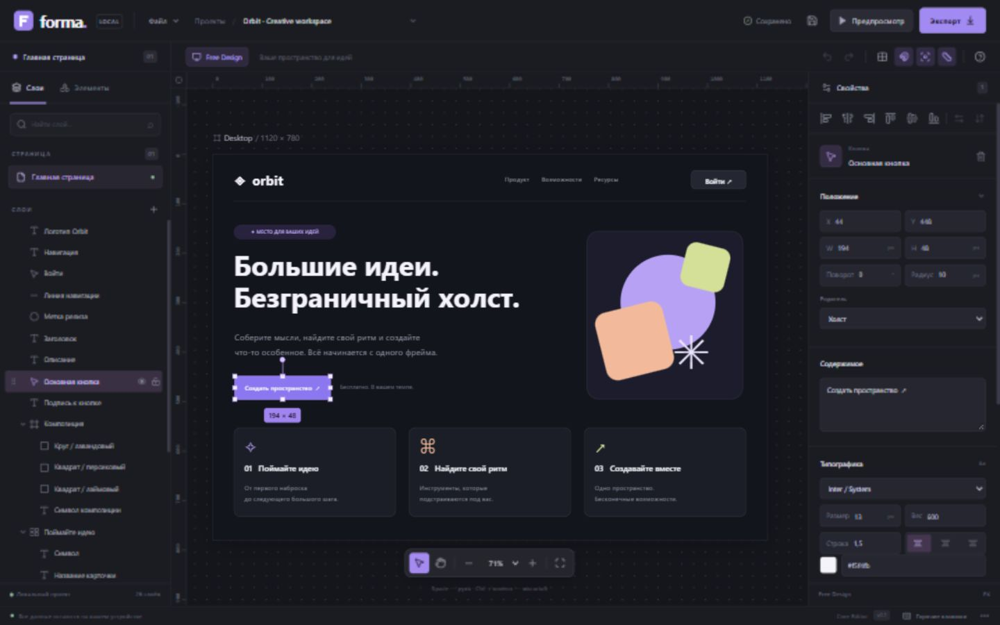
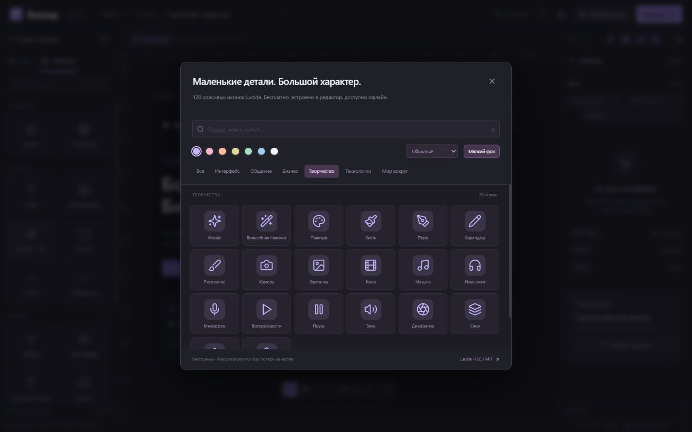
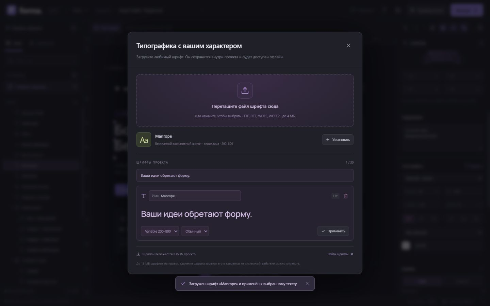
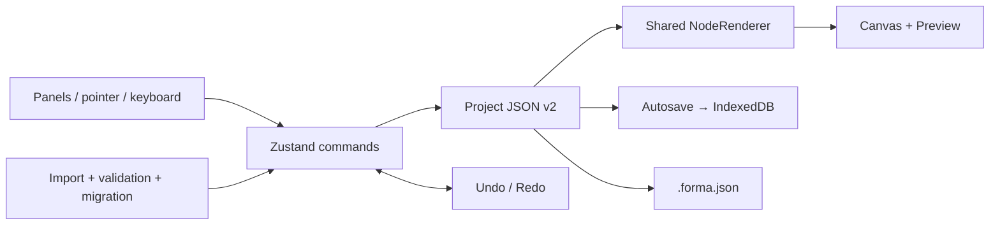

<div align="center">


# forma.

### Big ideas. An infinite canvas.

A local visual interface builder. Shape your idea, layer by layer.

[](https://github.com/TikTak-creator/Universal_Ai_Builder/releases/latest)    

**English** · [Русский](readme_ru.md)

[**Download for Windows ↗**](https://github.com/TikTak-creator/Universal_Ai_Builder/releases/latest) · [First steps](#your-first-design) · [For developers](#for-developers) · [Roadmap](#what-comes-next)

</div>

> The banner is decorative fan art. The screenshots below show the real editor. Forma is an independent project with no affiliation to Jujutsu Kaisen.

---

## A workspace for your next idea

Forma turns interface ideas into editable visual documents: add components, arrange nested layers, tune typography and effects, and preview the result. Projects stay on your device. No account, application server, API key, or paid service is required.

**v0.3.0 brings a Windows desktop edition and installer to the existing Visual Toolkit editor.** The web edition remains available. The editor language is Russian; these docs and the installer are available in English and Russian.

Despite the repository name, AI integrations and generated HTML/React/Flutter applications are **not implemented**. Current export produces an editable `.forma.json` document.



## Choose your edition

| You want to… | Download / command | What you need |
| --- | --- | --- |
| Install and start designing | **`Forma-0.3.0-Setup-win-x64.exe`** | Windows 10/11 x64; runtime included |
| Run without installing | `Forma-0.3.0-Windows-x64.zip` → extract **all** files → `Forma.exe` | Windows x64; projects still use AppData |
| Develop or inspect the code | `Forma-0.3.0-Source.zip` or Git clone | Supported Node.js and npm |
| Host the web edition | `Forma-0.3.0-Web.zip` | Static HTTP(S) hosting at the origin root |

All downloads are on the **[Releases page](https://github.com/TikTak-creator/Universal_Ai_Builder/releases/latest)**. `SHA256SUMS.txt` and `release-manifest.json` identify the files and source commit. The installer is per-user and needs no administrator rights. It creates desktop and Start menu shortcuts and includes an uninstaller.

The Windows binaries are unsigned: Windows may show an unknown-publisher or SmartScreen prompt. Verify the official release and SHA-256 before deciding to run them. No automatic updater is included.

**[Installation, backups, updates and troubleshooting →](docs/DESKTOP.md)**

## What you can build today

| Compose | Refine | Keep your work |
| --- | --- | --- |
| 14 component types | Typography and project fonts | Local autosave |
| Nested frames and containers | 120 bundled Lucide icons | Multiple local projects |
| Drag, resize and rotate | Gradients, shadows, blur and glow | JSON import and export |
| Alignment, distribution, grouping | Independent corner radii | Embedded fonts and local images |
| Grid, snapping, rulers and guides | Shared canvas / Preview renderer | Undo / redo during the session |

**Components:** Frame, Container, Text, Image, Icon, Shape, Line, Divider, Button, Input, Textarea, Checkbox, Select, Badge.

- **Canvas:** 10–800% zoom, panning, 8 px grid, smart guides, marquee and multi-selection. Move selected elements together; individual elements support eight resize handles and rotation.
- **Layers:** search, reorder, nest, hide and lock. Parent visibility and locking apply to descendants; reparenting preserves world position and rotation. Tree commands prevent cycles.
- **Appearance:** solid and gradient fills, borders, up to eight shadows, glow, blur, blend modes, image fit and detailed typography. Import TTF, OTF, WOFF and WOFF2 fonts; bundled Manrope includes Cyrillic.
- **Preview:** inspect the same rendered document and try form controls. Preview field values are temporary; custom button actions and layout reflow are not implemented.

<details>
<summary><strong>See the icon library and font manager</strong></summary>





</details>

## Your first design

1. Start Forma and explore the **Orbit** demonstration.
2. Open **Файл → Новый проект** to choose a blank canvas, its name and dimensions.
3. Click or drag components from **Элементы**. New elements enter a selected Frame or Container; use the layer tree or **Родитель** to change their parent.
4. Move and resize the elements. Edit text, geometry, fills and effects in the right inspector.
5. Add an icon, open **Aa** for fonts, and try **Предпросмотр**.
6. Wait for **Сохранено**, then use **Экспорт → Скачать JSON** to make a backup. On Windows, choose a destination in the save dialog. Cancelling it does not create a file.

Try [Orbit](examples/orbit.forma.json) and [Visual Toolkit](examples/visual-toolkit.forma.json) through **Файл → Импорт JSON**. Source ZIP includes both examples; desktop packages include them under `resources/examples/`.

### The shortcuts you'll use most

| Shortcut | Action |
| --- | --- |
| `V` / `H` · `Space + drag` | Select / hand · temporarily pan |
| `Ctrl + wheel` · `Shift + 1` | Zoom · fit canvas |
| `Shift + click` · `Ctrl + A` | Multi-select · select available elements |
| Arrow keys / `Shift + arrows` | Move 1 / 10 px |
| `Shift + resize` / rotate | Preserve aspect ratio / snap rotation to 15° |
| `Alt + drag` | Temporarily disable snapping |
| `Ctrl + Z` / `Ctrl + Shift + Z` | Undo / redo |
| `Ctrl + C` / `X` / `V` · `Ctrl + D` | Internal clipboard · duplicate |
| `Ctrl + G` / `Ctrl + Shift + G` | Group / ungroup |
| `Ctrl + S` / `Ctrl + Shift + S` | Save / save a copy |
| `Ctrl + N` / `O` / `E` | New / open / export |
| `Delete` · `Escape` · `F1` | Delete · cancel gesture / exit Preview · help |

Shortcuts respect text fields and work with Russian keyboard layouts. Clipboard is internal to the editor; it does not transfer elements between applications. Multi-selection resize and rotation are not implemented.

## Your files stay yours

Autosave writes to IndexedDB **700 ms** after a change when the gesture has finished. The last saved project is restored at startup. Undo/redo keeps up to **100 snapshots in memory** and resets when the session ends.

| Edition | Local project store |
| --- | --- |
| Windows installed / no-install ZIP | `%APPDATA%\Forma` → IndexedDB at `app://forma/` |
| Browser | Browser profile + origin, including protocol, host and port |

The two Windows packages share their default profile. Browser stores are separate; `localhost`, `127.0.0.1` and different ports are separate origins. Transfer work using `.forma.json`, not by expecting automatic synchronization.

JSON contains the tree, geometry, styles, guides and embedded fonts/images. URL images remain URLs and require access to their source. Export backups before clearing browser data. Windows uninstall keeps the profile; manually deleting it removes local work. Forma does not encrypt the profile or offer cloud backup.

No app backend, telemetry service or login is added. The bundled editor works offline; external images and links still access their respective sites. The web edition has no Service Worker/PWA install flow.

## For developers

### Run from source

Use **Node.js 22.12+ within 22.x, 24.x, or 26+**, npm and Git. Initial dependency installation requires internet. Windows packaging requires Windows x64; browser development can use another supported Node platform.

```bash
git clone https://github.com/TikTak-creator/Universal_Ai_Builder.git
cd Universal_Ai_Builder
git switch redbox/desktop-release
npm ci
npm run dev
```

Open **http://127.0.0.1:5173/**. Windows users can also run [START.cmd](START.cmd) for the web edition. It requires Node/npm and keeps a terminal server running; the downloadable desktop app does not.

| Command | Purpose |
| --- | --- |
| `npm run dev` | Web development on loopback, fixed port 5173 |
| `npm test` / `npm run test:desktop` | Editor tests / desktop asset and security-policy tests |
| `npm run typecheck` | Strict TypeScript check |
| `npm run build` / `npm run preview` | Build web `dist/` / preview over HTTP |
| `npm run desktop` | Build the web bundle and start Electron |
| `npm run package:win` | Package the current working directory for Windows |
| `npm run release:win` | Build all release assets from a clean committed snapshot |

On PowerShell systems that block `npm.ps1`, use `npm.cmd`. Preview runs on a different origin from development and therefore uses a separate browser store. Serve web builds from the origin root; `file://` and subdirectory deployment are not configured.

### Stack and architecture

| Technology | Responsibility |
| --- | --- |
| React 19 · TypeScript 5.7 | UI, document types, renderer |
| Zustand 5 | Commands, selection, history, document state |
| Vite 6.4 · Tailwind CSS 4 | Bundling and styling |
| dnd-kit · Lucide React | Layer interactions and icons |
| IndexedDB · FontFace | Persistence and embedded font loading |
| Electron 44.9 · electron-builder 26.15 | Sandboxed Windows host and NSIS installer |
| Vitest 5 · fake-indexeddb · Node test runner | Model/storage tests and desktop policy tests |



The document is the source of truth. Commands change it, React renders it; raw DOM mutations do not become saved design state. Coordinates are parent-relative; geometry helpers account for ancestor rotation. Legacy v1 JSON migrates to schema v2, and unknown future schemas are rejected.

```text
src/
  model/       types, validation, migration, styles
  engine/      geometry and safe tree operations
  store/       commands, clipboard and history
  canvas/      pointer gestures, selection and snapping
  renderer/    shared recursive NodeRenderer
  panels/      layers, inspector and property editors
  assets/      icon catalog and fonts
  storage/     IndexedDB
  hooks/       autosave, shortcuts and font registration
  components/  dialogs, Preview and asset managers
desktop/       Electron host, policies, icon and tests
scripts/       isolated release build and manifest
public/        bundled fonts and asset notices
examples/      editable JSON projects
docs/          guides, architecture and verification
```

The desktop renderer has no Node integration, preload bridge or IPC surface. Context isolation and sandboxing are enabled. The host serves only the built app at `app://forma/`, sets a CSP, blocks navigation and permissions, and opens only two explicitly allowed reference URLs in the system browser. Existing document validation remains responsible for JSON content. This is a hardening baseline, not an independent security audit. See [desktop/main.cjs](desktop/main.cjs) and [security.cjs](desktop/security.cjs).

### Extend without breaking saved projects

- **A component:** update `ComponentType`, the registry and renderer; add inspector controls and document validation. Container types must follow the tree invariants.
- **A property:** define its type, default and validation, expose it in the inspector, and modify it through store commands so history and saving stay consistent.
- **An asset:** give it a stable ID, handle serialization and search, and preserve its license notice.
- **A schema:** update version and migration together, keep older documents readable and test JSON round trips.

Import limits: 25 MB JSON, 5,000 components, 100 hierarchy levels, 8 MB per image, 4 MB per font, 16 MB total fonts and 30 fonts. These are validation bounds; performance at the maximum document size has not been certified.

**[Architecture](docs/ARCHITECTURE.md)** · **[Customization](docs/CUSTOMIZATION.md)** · **[Web test report](docs/TESTING.md)** · **[Desktop verification](docs/TESTING-DESKTOP.md)** · **[Build a release](docs/RELEASES.md)**

### Branches and versions

| Ref | Purpose |
| --- | --- |
| `main` | Current documented stable source |
| `redbox/desktop-release` | Desktop packaging and v0.3.0 release work |
| `v0.3.0` | Fixed source snapshot for the downloadable release |
| `ed71108` | Preserved original web-editor baseline in Git history |

Release files come from an exported committed tree. The manifest records that commit; generated dependencies, user profiles, build output and credentials are excluded from source ZIPs. See [CHANGELOG.md](CHANGELOG.md).

## What comes next

| Available now | Future work — not implemented |
| --- | --- |
| Free positioning on one canvas | Flex/Grid, constraints, breakpoints and responsive reflow |
| Local styling, fonts and effects | Shared design tokens and reusable component instances |
| Visual Preview and basic form controls | Events, conditions, navigation, HTTP actions and animation timeline |
| Editable JSON export | HTML/CSS/JS, React and Flutter generators |
| Local Windows/web projects | Cloud sync, accounts and collaboration |
| Windows x64 packages | Signed builds, auto-update, other OS/architectures |

Other priorities: browser E2E automation, CI builds, accessibility, command search, large-document profiling and a hosted demo. Reserved fields such as `events`, `animations`, `dataBindings` and `responsiveOverrides` do not imply working engines. The [original brief](docs/BRIEF.ru.md) describes a wider vision.

## Documentation and licenses

| Guide | Audience |
| --- | --- |
| [Windows guide / инструкция](docs/DESKTOP.md) | Install, save, back up and update — EN/RU |
| [Architecture](docs/ARCHITECTURE.md) | Developers — Russian |
| [Customization](docs/CUSTOMIZATION.md) | Icons, fonts, corners and effects — Russian |
| [Releases](docs/RELEASES.md) | Reproduce and verify release packages — EN/RU |
| [Changelog](CHANGELOG.md) | Changes and existing boundaries |

Lucide: [ISC notice](public/licenses/lucide.txt); Feather: [MIT notice](public/licenses/feather-mit.txt); Manrope: [SIL OFL](public/fonts/OFL.txt). Electron/Chromium notices ship with the desktop distribution. Imported assets retain their own licenses. [Documentation artwork provenance](docs/assets/README.md).

**No source-code license has been selected for Forma.** Public source availability and third-party notices do not grant an additional license to the whole project.

<div align="center">

**Start with one frame. Make it yours.**

[Download Forma](https://github.com/TikTak-creator/Universal_Ai_Builder/releases/latest) · [Report an issue](https://github.com/TikTak-creator/Universal_Ai_Builder/issues) · [Русская версия](readme_ru.md)

</div>
