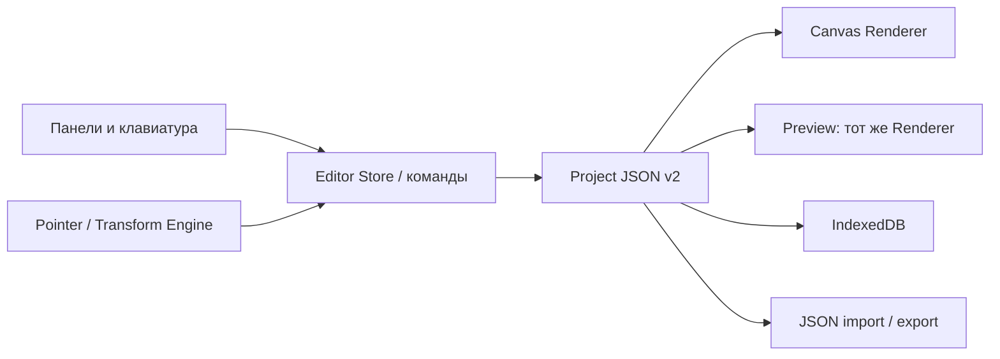

# Архитектура редактора v0.2

## Единственный источник данных

`Project` — сериализуемый документ версии 2. Все элементы хранятся в `nodes`, порядок задаётся `rootIds`/`children`, обратная ссылка — `parentId`. Массив `fonts` содержит локальные ресурсы шрифтов. Элемент содержит ID, тип, имя, геометрию, свойства, стили, layout и зарезервированные поля responsiveOverrides/states/events/animations/dataBindings. Зарезервированные поля не являются реализованными движками.

Холст никогда не сохраняет результат перетаскивания прямым изменением DOM. Pointer Engine вычисляет геометрию → команда меняет документ → React рисует новое состояние. DOM используется для событий и размеров окна.

## Модули

| Путь | Ответственность |
| --- | --- |
| `src/model/types.ts` | Платформенно независимые типы, версия схемы |
| `src/model/document.ts` | Создание документов/демо, сериализация, валидация, входная миграция |
| `src/registry/components.ts` | Реестр 14 типов, фабрика и свойства по умолчанию |
| `src/model/customization.ts` | Независимые углы, градиенты, тени, CSS-генерация и валидация стилей |
| `src/assets/iconLibrary.ts` | Офлайн-каталог 120 SVG-иконок, категории, поиск |
| `src/assets/fonts.ts` | Подготовка и проверка файлов, FontFace-кэш, слияние шрифтов при вставке |
| `src/hooks/useProjectFonts.ts` | Регистрация FontFace в документе, переключение проектов, ошибки декодирования |
| `src/components/IconPicker.tsx` | Выбор, оформление и атомарная вставка иконок |
| `src/components/FontManager.tsx` | Импорт, Manrope, образец, метаданные и применение/удаление шрифтов |
| `src/panels/CornerEditor.tsx` | Независимые радиусы, связанный режим и pointer-жесты |
| `src/panels/AppearancePanels.tsx` | Заливка, рамка, тени, эффекты и параметры иконки |
| `src/panels/TypographyPanel.tsx` | Шрифты проекта и настройки текста |
| `src/engine/geometry.ts` | Координаты, повороты родителей, resize, selection bounds, snapping |
| `src/engine/operations.ts` | Чистые операции над документом: дерево, группы, reparent, дубликаты, align/distribute |
| `src/store/editor.ts` | Zustand-команды, состояние выбора, внутренний clipboard, Undo/Redo, транзакции жестов |
| `src/canvas/Canvas.tsx` | Pointer lifecycle, панорама, зум, сетка, линейки, направляющие, рамка выделения, маркеры |
| `src/renderer/NodeRenderer.tsx` | Рекурсивная отрисовка, общая для Canvas и Preview |
| `src/panels/LayersPanel.tsx` | Библиотека, поиск, дерево слоёв, dnd-kit |
| `src/panels/Inspector.tsx` | Контекстный инспектор и импорт картинок |
| `src/panels/Fields.tsx` | Поля с локальным draft и группировкой истории ввода |
| `src/storage/projects.ts` | IndexedDB-транзакции проектов и указателя последнего документа |
| `src/hooks/usePersistence.ts` | Загрузка, очередь записей, debounce автосохранения, ошибки, beforeunload |
| `src/hooks/useShortcuts.ts` | Горячие клавиши с исключением полей ввода и диалогов |
| `src/components/` | Диалоги, JSON download, preview, context menu и базовые UI-компоненты |

## История

Команда создаёт отдельную копию документа и меняет её. Предыдущий документ сохраняется в историю только при фактическом изменении. Во время pointer-жеста или фокуса в поле существует исходный snapshot; все промежуточные изменения объединяются в одну запись. Escape восстанавливает исходный snapshot. Новый edit после Undo очищает redo-ветку. Размер истории ограничен 100 записями.

Выбор, панорама, масштаб и UI-переключатели не входят в документ и не засоряют историю. Направляющие входят в документ.

## Геометрия и структура

Все координаты локальны относительно родителя. Рекурсивное вычисление центров и углов переводит их в систему холста. Перемещение переводит мировой delta обратно через обратный поворот родителя. Смена родителя сохраняет мировой центр и суммарный угол. Включение родителя и его потомка в выбор не приводит к двойному перемещению.

Циклы запрещены. Скрытие и блокировка наследуются. Группировка сохраняет исходный порядок детей и их мировую геометрию. Обводка рисуется отдельным неинтерактивным overlay с border-radius родителя, чтобы не смещать начало координат детей и поддерживать solid/dashed/dotted. Внешние и внутренние тени задаются отдельно.

## Хранение и импорт

База `forma-ui-builder`, object stores `projects` и `settings`. Запись документа и lastProject выполняется одной транзакцией. Записи выстроены в очередь, чтобы старый autosave не перезаписал новый. Ошибки записи не считаются успешным сохранением.

`parseProject` проверяет схему, размеры, типы компонентов, ссылки parent/children, циклы, повторные ID, потерянные узлы, геометрию, стили, иконки, встроенные шрифты и поддерживаемый layout. Неизвестная будущая версия отклоняется. Отсутствие schemaVersion считается legacy v1. Документы v1 дополняются новыми стилями и свойствами по умолчанию и мигрируют в v2; общий радиус и геометрия сохраняются. Максимальная импортируемая глубина — 100.

## Шрифты и векторные ресурсы

Иконка хранит ID каталога, толщину и два флага отражения. SVG-компоненты импортируются явно, без загрузки внешних ресурсов и выполнения пользовательской разметки.

Шрифт хранит base64 data URL, формат, стабильное внутреннее CSS-семейство, отображаемое имя, вес и стиль; для Manrope также сохраняется OFL-лицензия. При загрузке проверяются расширение, байтовая сигнатура, размер и реальное декодирование FontFace. Импорт JSON проверяет только локальные base64-ресурсы, уникальность ID/семейств, формат и лимиты. Ошибка декодирования импортированного шрифта показывается пользователю; выполняется системный fallback.

Кэш FontFace переиспользует уже декодированные байты. При смене документа, удалении, Undo/Redo или изменении дескрипторов меняется регистрация в `document.fonts`. Clipboard переносит только использованные шрифты и разрешает коллизии ID/семейств при вставке в другой документ. Внешних font CSS и CDN-запросов нет.

## Расширение

Новый тип компонента требует определения в registry, renderer и тестов. Новые свойства добавляются в документ и Inspector, а не сохраняются в DOM. Для новых версий схемы миграции расширяются в `parseProject`.

Оставшаяся Phase 2 потребует Layout Engine, дизайн-токены и типизированные breakpoint overrides. На Phase 3 нужны сериализуемые типы действий/выражений и общий Event Runtime. На Phase 4 — типизированные keyframes и Animation Engine. На Phase 5 — отдельный Export Engine с интерфейсом генератора и отчётом совместимости. Flutter получит независимое сопоставление widgets; повторное использование HTML как Dart-шаблона не предусмотрено. Эти будущие модули пока не объявлены готовыми.
