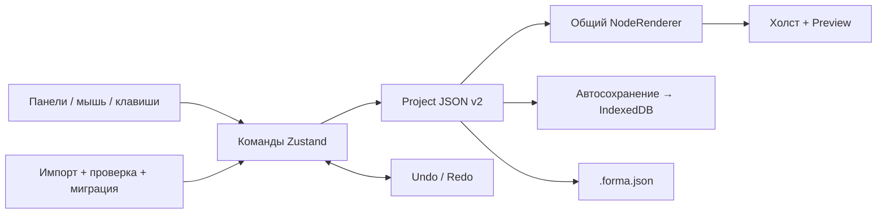

<div align="center">


# forma.

### Большие идеи. Безграничный холст.

Локальный визуальный конструктор интерфейсов. От идеи — к макету, слой за слоем.

[](https://github.com/TikTak-creator/Universal_Ai_Builder/releases/latest)    

[English](README.md) · **Русский**

[**Скачать для Windows ↗**](https://github.com/TikTak-creator/Universal_Ai_Builder/releases/latest) · [Первый макет](#ваш-первый-макет) · [Разработчикам](#разработчикам) · [Планы](#что-дальше)

</div>

> Баннер — декоративный фан-арт. Ниже показаны настоящие скриншоты редактора. Forma — независимый проект, не связанный с правообладателями Jujutsu Kaisen.

---

## Пространство для вашей следующей идеи

Forma помогает собирать интерфейсы визуально: добавлять компоненты, работать со вложенными слоями, настраивать шрифты и эффекты, а затем проверять макет в предпросмотре. Проекты остаются на вашем устройстве. Аккаунт, сервер приложения, API-ключ и платный сервис не нужны.

**В v0.3.0 появился Windows-клиент с установщиком для уже работающего Visual Toolkit.** Веб-версия также доступна. Сам редактор русскоязычный; README и установщик доступны на русском и английском.

Несмотря на название репозитория, интеграция AI и генераторы приложений HTML/React/Flutter **пока не реализованы**. Текущий экспорт создаёт редактируемый документ `.forma.json`.


## Выберите способ запуска

| Что хотите сделать | Файл / команда | Что понадобится |
| --- | --- | --- |
| Установить и сразу рисовать | **`Forma-0.3.0-Setup-win-x64.exe`** | Windows 10/11 x64; среда запуска внутри |
| Запустить без установки | `Forma-0.3.0-Windows-x64.zip` → распаковать **всё** → `Forma.exe` | Windows x64; данные по-прежнему в AppData |
| Изучать и менять код | `Forma-0.3.0-Source.zip` или Git clone | Поддерживаемая Node.js и npm |
| Разместить веб-версию | `Forma-0.3.0-Web.zip` | Статический HTTP(S)-хостинг в корне сайта |

Все файлы — на **[странице релизов](https://github.com/TikTak-creator/Universal_Ai_Builder/releases/latest)**. Рядом находятся `SHA256SUMS.txt` и `release-manifest.json` с хешами и исходным коммитом. Установщик работает для текущего пользователя без администратора, добавляет ярлыки и программу удаления.

У Windows-файлов нет цифровой подписи: возможны сообщения SmartScreen и неизвестного издателя. Перед запуском проверьте официальный релиз и SHA-256. Автообновления нет.

**[Установка, резервные копии, обновления и решение проблем →](docs/DESKTOP.md)**

## Что уже работает

| Собирайте | Настраивайте | Сохраняйте |
| --- | --- | --- |
| 14 типов компонентов | Типографика и свои шрифты | Локальное автосохранение |
| Вложенные фреймы и контейнеры | 120 встроенных иконок Lucide | Несколько локальных проектов |
| Перемещение, resize и поворот | Градиенты, тени, blur и glow | Импорт и экспорт JSON |
| Выравнивание, распределение, группы | Независимые радиусы углов | Встроенные шрифты и картинки |
| Сетка, привязки, линейки, направляющие | Общий рендер холста и Preview | Отмена и повтор в текущем сеансе |

**Компоненты:** Frame, Container, Text, Image, Icon, Shape, Line, Divider, Button, Input, Textarea, Checkbox, Select, Badge.

- **Холст:** масштаб 10–800%, панорамирование, сетка 8 px, умные направляющие, рамочное и множественное выделение. Выбранные элементы перемещаются вместе; у отдельного элемента — восемь маркеров размера и поворот.
- **Слои:** поиск, порядок, вложенность, скрытие и блокировка. Потомки наследуют скрытие и блокировку родителя; смена родителя сохраняет мировую позицию и поворот. Операции дерева предотвращают циклы.
- **Оформление:** заливки и градиенты, рамки, до восьми теней, свечение, размытие, режимы наложения и типографика. Поддерживаются TTF, OTF, WOFF, WOFF2; встроенный Manrope содержит кириллицу.
- **Предпросмотр:** тот же рендер документа и простые поля формы. Введённые значения временные; пользовательских действий кнопок и адаптивной перестройки пока нет.

<details>
<summary><strong>Посмотреть библиотеку иконок и менеджер шрифтов</strong></summary>


</details>

## Ваш первый макет

1. Откройте Forma и изучите демонстрацию **Orbit**.
2. Через **Файл → Новый проект** выберите чистый холст, название и размеры.
3. Нажимайте на компоненты в **Элементы** или перетаскивайте их. Если выбран Frame или Container, новый элемент попадёт внутрь; вложенность меняется в дереве или поле **Родитель**.
4. Перемещайте элементы и меняйте размер. Справа редактируйте текст, геометрию, заливку и эффекты.
5. Добавьте иконку, откройте шрифты кнопкой **Aa**, проверьте **Предпросмотр**.
6. Дождитесь **Сохранено**, затем сделайте копию через **Экспорт → Скачать JSON**. В Windows выберите папку в системном диалоге; его отмена не создаёт файл.

Откройте [Orbit](examples/orbit.forma.json) и [Visual Toolkit](examples/visual-toolkit.forma.json) через **Файл → Импорт JSON**. Оба примера есть в исходниках; внутри Windows-пакета они лежат в `resources/examples/`.

### Основные горячие клавиши

| Сочетание | Действие |
| --- | --- |
| `V` / `H` · `Space + drag` | Выделение / рука · временно двигать холст |
| `Ctrl + колесо` · `Shift + 1` | Масштаб · вместить холст |
| `Shift + клик` · `Ctrl + A` | Несколько элементов · выделить доступные |
| Стрелки / `Shift + стрелки` | Сдвиг на 1 / 10 px |
| `Shift + resize` / поворот | Сохранять пропорции / шаг поворота 15° |
| `Alt + drag` | Временно отключить привязки |
| `Ctrl + Z` / `Ctrl + Shift + Z` | Отмена / повтор |
| `Ctrl + C` / `X` / `V` · `Ctrl + D` | Внутренний буфер · дублирование |
| `Ctrl + G` / `Ctrl + Shift + G` | Группировать / разобрать |
| `Ctrl + S` / `Ctrl + Shift + S` | Сохранить / сохранить копию |
| `Ctrl + N` / `O` / `E` | Новый / открыть / экспорт |
| `Delete` · `Escape` · `F1` | Удалить · отменить жест / выйти из Preview · помощь |

Сочетания учитывают фокус в текстовых полях и русскую раскладку. Буфер обмена внутренний: между приложениями элементы не переносятся. Resize и поворот множественного выделения пока отсутствуют.

## Ваши проекты остаются у вас

Автосохранение записывает документ в IndexedDB через **700 мс** после изменения, когда жест завершён. При запуске восстанавливается последняя сохранённая работа. История хранит до **100 снимков в оперативной памяти** и не переживает закрытие сеанса.

| Версия | Где находятся проекты |
| --- | --- |
| Windows: установленная и ZIP | `%APPDATA%\Forma` → IndexedDB с адресом `app://forma/` |
| Браузер | В профиле браузера и конкретном origin: протокол, адрес, порт |

У двух Windows-пакетов общий профиль по умолчанию. У браузеров хранилища отдельные: `localhost`, `127.0.0.1` и разные порты — разные origin. Переносите работы через `.forma.json`; синхронизации между ними нет.

JSON включает дерево, геометрию, стили, направляющие и встроенные шрифты/картинки. Внешние картинки остаются URL и требуют доступного источника. Перед очисткой браузера экспортируйте резервные копии. Удаление Windows-приложения сохраняет профиль; ручное удаление профиля уничтожает работы. Шифрования и облачных резервных копий в Forma нет.

Сервер приложения, телеметрия и авторизация не добавлены. Встроенный редактор работает офлайн; внешние картинки и ссылки обращаются к своим сайтам. У веб-версии нет Service Worker и установки PWA.

## Разработчикам

### Запуск из исходников

Нужны **Node.js 22.12+ в ветке 22.x, 24.x или 26+**, npm и Git. Для первой установки зависимостей нужен интернет. Сборка Windows-пакета выполняется на Windows x64; веб-разработкой можно заниматься и на другой поддерживаемой Node платформе.

```bash
git clone https://github.com/TikTak-creator/Universal_Ai_Builder.git
cd Universal_Ai_Builder
git switch redbox/desktop-release
npm ci
npm run dev
```

Откройте **http://127.0.0.1:5173/**. В Windows есть [START.cmd](START.cmd) для веб-версии: он требует Node/npm и держит терминальный сервер открытым. Готовое приложение из релиза этого не требует.

| Команда | Для чего |
| --- | --- |
| `npm run dev` | Веб-разработка на loopback, фиксированный порт 5173 |
| `npm test` / `npm run test:desktop` | Тесты редактора / проверки ресурсов и политик оболочки |
| `npm run typecheck` | Строгая проверка TypeScript |
| `npm run build` / `npm run preview` | Веб-сборка в `dist/` / её локальный HTTP-просмотр |
| `npm run desktop` | Собрать веб-код и запустить Electron |
| `npm run package:win` | Упаковать текущие рабочие файлы для Windows |
| `npm run release:win` | Все файлы релиза из чистого зафиксированного коммита |

Если PowerShell блокирует `npm.ps1`, используйте `npm.cmd`. Preview и dev имеют разные origin и отдельные браузерные хранилища. Веб-сборка рассчитана на корень сайта; `file://` и размещение во вложенной папке не настроены.

### На чём написано и как устроено

| Технология | Роль |
| --- | --- |
| React 19 · TypeScript 5.7 | Интерфейс, типы документов и рендер |
| Zustand 5 | Команды, выделение, история, состояние |
| Vite 6.4 · Tailwind CSS 4 | Сборка и стили |
| dnd-kit · Lucide React | Дерево слоёв и иконки |
| IndexedDB · FontFace | Хранилище и загрузка встроенных шрифтов |
| Electron 44.9 · electron-builder 26.15 | Изолированная Windows-оболочка и NSIS-установщик |
| Vitest 5 · fake-indexeddb · Node test runner | Тесты модели/хранилища и desktop-политик |



Документ — единый источник данных: команды меняют его, React отображает результат. Прямое изменение DOM не становится состоянием макета. Координаты заданы относительно родителя; геометрия учитывает поворот предков. Старые документы v1 мигрируют в схему v2; неизвестные будущие версии отклоняются.

```text
src/
  model/       типы, проверки, миграция, стили
  engine/      геометрия и безопасные операции дерева
  store/       команды, буфер обмена, история
  canvas/      жесты, выделение, привязки
  renderer/    общий рекурсивный NodeRenderer
  panels/      слои, инспектор, редакторы свойств
  assets/      каталог иконок и шрифты
  storage/     IndexedDB
  hooks/       автосохранение, сочетания клавиш, шрифты
  components/  диалоги, Preview, менеджеры ресурсов
desktop/       оболочка Electron, политики, иконка, тесты
scripts/       сборка релиза и манифеста
public/        шрифты и лицензии ресурсов
examples/      редактируемые JSON-проекты
docs/          руководства, архитектура, проверки
```

У desktop-рендера нет доступа к Node.js, preload-моста и IPC. Включены sandbox и context isolation. Оболочка выдаёт файлы только из собранного приложения на `app://forma/`, задаёт CSP, запрещает навигацию и разрешения, а в системном браузере открывает лишь две явно разрешённые справочные ссылки. Содержимое JSON проверяет существующая модель. Это базовое укрепление оболочки, не независимый аудит безопасности. Код: [main.cjs](desktop/main.cjs), [security.cjs](desktop/security.cjs).

### Как расширять проект

- **Компонент:** добавьте `ComponentType`, запись реестра и рендер, затем поля инспектора и валидацию. Для контейнера соблюдайте ограничения дерева.
- **Свойство:** определите тип, значение по умолчанию и проверку, покажите поле в инспекторе. Изменяйте через команды store для согласованной истории и сохранения.
- **Ресурс:** задайте стабильный ID, поддержите сериализацию и поиск, сохраните лицензионное уведомление.
- **Схема:** меняйте версию вместе с миграцией, сохраняйте чтение старых проектов и тестируйте JSON round trip.

Пределы валидации: JSON 25 МБ, 5 000 компонентов, 100 уровней дерева, 8 МБ на картинку, 4 МБ на шрифт, 16 МБ шрифтов суммарно и до 30 шрифтов. Производительность на предельном размере не сертифицирована.

**[Архитектура](docs/ARCHITECTURE.md)** · **[Кастомизация](docs/CUSTOMIZATION.md)** · **[Веб-проверки](docs/TESTING.md)** · **[Desktop-проверки](docs/TESTING-DESKTOP.md)** · **[Сборка релиза](docs/RELEASES.md)**

### Ветки и версии

| Ссылка | Назначение |
| --- | --- |
| `main` | Текущие стабильные исходники с документацией |
| `redbox/desktop-release` | Работа над Windows-упаковкой и релизом v0.3.0 |
| `v0.3.0` | Зафиксированные исходники опубликованного релиза |
| `ed71108` | Исходная веб-версия, сохранённая в истории Git |

Файлы релиза собираются из экспортированного коммита; его ID записан в манифесте. Зависимости, профили пользователей, результаты сборки и секреты не входят в Source ZIP. История изменений: [CHANGELOG.md](CHANGELOG.md).

## Что дальше

| Уже есть | Планы — пока не реализовано |
| --- | --- |
| Свободное расположение на одном холсте | Flex/Grid, constraints, breakpoints и адаптивная перестройка |
| Стили, шрифты, эффекты | Общие дизайн-токены и экземпляры компонентов |
| Визуальный Preview и простые поля | События, условия, навигация, HTTP-действия, timeline |
| Редактируемый JSON | Генераторы HTML/CSS/JS, React и Flutter |
| Локальные проекты Windows/web | Облачная синхронизация, аккаунты, совместная работа |
| Пакеты Windows x64 | Подписанные сборки, автообновления и другие платформы |

Также нужны автоматизация браузерных сценариев, CI, доступность, поиск команд, замеры больших документов и опубликованная демоверсия. Поля `events`, `animations`, `dataBindings`, `responsiveOverrides` зарезервированы; это не готовые движки. Более широкий замысел — в [исходном брифе](docs/BRIEF.ru.md).

## Документация и лицензии

| Документ | Для кого |
| --- | --- |
| [Windows: установка и работа](docs/DESKTOP.md) | Пользователям: установка, копии и обновление — RU/EN |
| [Архитектура](docs/ARCHITECTURE.md) | Разработчикам — русский |
| [Кастомизация](docs/CUSTOMIZATION.md) | Иконки, шрифты, углы, эффекты — русский |
| [Сборка релизов](docs/RELEASES.md) | Воспроизводимая упаковка и проверка — EN/RU |
| [Изменения](CHANGELOG.md) | Возможности версии и ограничения |

Lucide: [ISC](public/licenses/lucide.txt); Feather: [MIT](public/licenses/feather-mit.txt); Manrope: [SIL OFL](public/fonts/OFL.txt). Уведомления Electron/Chromium входят в Windows-дистрибутив. У импортированных ресурсов остаются свои лицензии. [Происхождение оформления](docs/assets/README.md).

**Лицензия исходного кода Forma пока не выбрана.** Публичность репозитория и лицензии сторонних ресурсов не задают дополнительную лицензию всему проекту.

<div align="center">

**Всё начинается с одного фрейма. Дальше — ваша идея.**

[Скачать Forma](https://github.com/TikTak-creator/Universal_Ai_Builder/releases/latest) · [Сообщить об ошибке](https://github.com/TikTak-creator/Universal_Ai_Builder/issues) · [English version](README.md)

</div>
